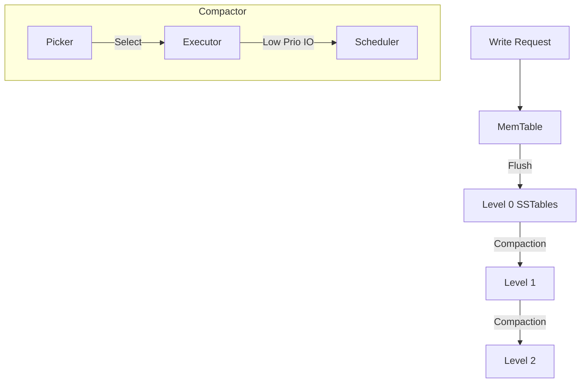

# yykv-compaction (LSM-Tree Compaction Engine)

`yykv-compaction` is the background maintenance kernel of the YYKV storage engine. It manages the SSTable merging process in the LSM-Tree architecture, aiming to ensure long-term read/write performance by eliminating spatial fragmentation, cleaning up deleted entries (Tombstones), and optimizing data layout.

## Core Features

### 🧹 Background Compaction
- **Space Amplification Control**: Automatically identifies levels that are too deep or have too many files and triggers merge tasks.
- **Cold Data Compaction**: Works with `yykv-tiering` to perform large-block merges when moving data to HDD, optimizing disk seek performance.

### 🛡️ Compaction Strategies
- **Leveled Compaction**: Strictly controls the amount of data in each level to provide more stable read latency.
- **Size-Tiered Compaction**: Optimizes write throughput, suitable for high-frequency write scenarios.
- **Time-Window Compaction**: Special optimization strategy for time-series data.

### ⚡ IO Isolation and Limitation
- Integrates with the **Low Priority** scheduling of `yykv-scheduler` to ensure the compaction process does not preempt disk bandwidth from frontend queries.
- Supports Rate Limiting to prevent sudden system IO jitter caused by compaction.

## Core Components

- `CompactionPicker`: Responsible for deciding which files need to be merged.
- `CompactionExecutor`: Executes the specific logic for reading, merging, sorting, and persisting data.
- `TombstoneCleaner`: Specifically responsible for cleaning up physically deleted entries.

## Technical Architecture

