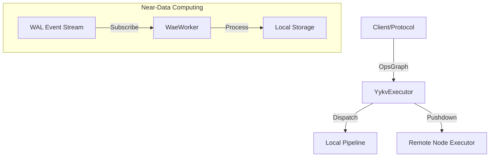

# yykv-executor (Distributed Execution Framework)

`yykv-executor` is the computational brain of the YYKV storage engine. It is responsible for converting abstract operator graphs (`OpsGraph`) into specific execution task streams and utilizes "Near-Data Computing" technology to complete data filtering and preprocessing locally on storage nodes as much as possible.

## Core Features

### 🚀 Operator Execution & Scheduling
- **OpsGraph Execution**: Converts logical execution plans from upper layers into physical operator pipelines, driving data flow.
- **Async Driven**: Based on the `tokio` runtime, implementing fully asynchronous, non-blocking compute task execution.

### 📡 Near-Data Computing
- **WAE Worker**: The core component that subscribes to WAL event streams generated by `yykv-event`, triggering predefined compute logic (such as index updates, materialized view maintenance) while data is being flushed to disk.
- **Task Pushdown**: Supports pushing simple operators like Filter and Project down to the nodes where data resides, significantly reducing cross-network data movement.

### 🛡️ Multi-Tenant Isolation
- Ensures that compute tasks for different tenants are strictly isolated in terms of CPU time slices and memory quotas, preventing the "noisy neighbor" effect.

## Core Components

- `YykvExecutor`: The global execution controller, responsible for task distribution and state management.
- `WaeWorker`: A compute unit specifically for handling real-time data event streams.
- `TaskContext`: Encapsulates tenant info, resource limits, and tracking IDs in the execution context.

## Technical Architecture

## Technical Advantages
- **Ultra-Low Latency**: Compute logic acts directly on physical pages or memory caches of `yykv-layout`.
- **Horizontal Scaling**: Supports dynamic scaling of compute nodes, with compute tasks capable of moving flexibly within the cluster.
