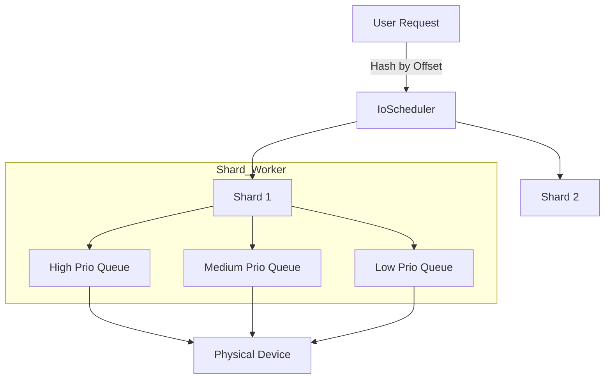

# yykv-scheduler (Priority-Aware IO Scheduler)

`yykv-scheduler` is the IO scheduling center for the YYKV storage engine. It ensures that frontend query requests maintain low latency even under the interference of complex background maintenance tasks (such as Compaction/GC) by categorizing IO requests by priority, implementing multi-shard (Sharding) concurrency control, and ensuring fair scheduling.

## Core Features

### 🚥 Priority-Driven Scheduling
The system categorizes all IO requests into three levels:
- **High**: Critical metadata reads/writes, sequential WAL writes. These requests preempt execution resources to ensure database responsiveness and safety.
- **Medium**: Standard user SQL queries and KV read/write requests.
- **Low**: Background Compaction, data Tiering, and Garbage Collection (GC). Executed only when system load is low to avoid slowing down normal operations.

### 🧩 IO Sharding Architecture
To eliminate single-queue lock contention, the scheduler implements a multi-sharding mechanism based on `PageId` or `Offset`.
- Each shard has an independent task queue and Worker coroutine.
- Reduces Context Switches and Cache Misses in multi-core environments.

### 🛡️ Concurrency Control and Backpressure
- **Semaphore Rate Limiting**: Each shard has a configurable semaphore to strictly control the number of in-flight IOs, preventing NVMe drive queue overflows.
- **Backpressure Awareness**: When queue backlog exceeds a threshold, it automatically returns a wait signal to upper layers to prevent memory OOM.

## Core Components

- `IoScheduler`: Global scheduling entry point, responsible for shard mapping.
- `IoShard`: Independent sharding execution unit, managing `high`/`med`/`low` channels.
- `IoPriority`: Enumeration definition for priorities.

## Usage Example

```rust
use yykv_scheduler::{IoScheduler, IoPriority, IoRequest};

let scheduler = IoScheduler::new(device, 16, 4); // 4 shards, 16 concurrency per shard

// Initiate a high-priority read request
let (tx, rx) = oneshot::channel();
scheduler.schedule(IoRequest::Read {
    offset: 4096,
    len: 4096,
    priority: IoPriority::High,
    resp: tx,
});

let data = rx.await??;
```

## Technical Design


