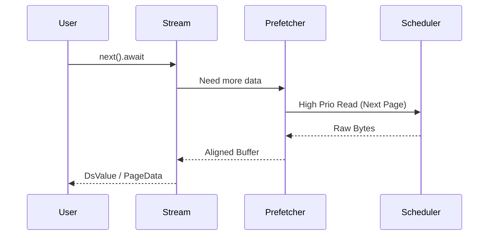

# Async Data Streaming Interface

**yykv-stream** provides an efficient asynchronous streaming data access interface for YYKV. It encapsulates complex underlying logic such as page prefetching and cache management, providing data iteration capabilities that conform to Rust's `Stream` trait for the upper-level engine.

## 1. Core Features

### 🌊 Async Scanning
Supports streaming reads of massive storage data, avoiding memory overflow (OOM) caused by one-time loading.
- **Zero-Copy Iteration**: Returns references to internal buffers whenever possible to reduce memory copy overhead.
- **Concurrent Prefetching**: While processing the current page, it asynchronously prefetches subsequent pages from `yykv-scheduler`, eliminating disk I/O wait times.

### 🛡️ Smart Backpressure Control
Works with the upper-level execution engine to dynamically adjust reading frequency based on consumer processing speed:
- Automatically pauses I/O submission when the buffer is full.
- Ensures system stability when handling large-scale aggregation or sorting tasks.

### 🧩 Multi-Tenant Awareness
The streaming interface naturally supports tenant isolation, ensuring each `Stream` can only access authorized physical pages.

## 2. Core Components

- `YykvStream`: The main stream object, implementing the `futures::Stream` trait.
- `Prefetcher`: Background page prefetcher, managing forward-looking I/O requests.

## 3. Usage Example

```rust
use yykv_stream::YykvStream;
use futures::StreamExt;

let mut stream = YykvStream::new(page_ids, scheduler);

while let Some(page_result) = stream.next().await {
    let page_data = page_result?;
    // Process page data...
}
```

## 4. Technical Design


