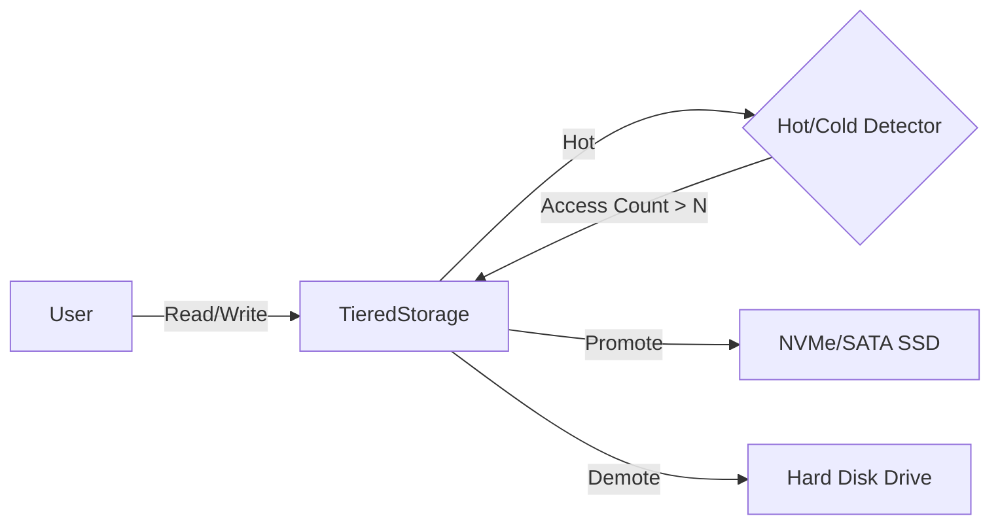

# Auto-Tiering Storage Engine

**yykv-tiering** is the cold and hot data tiering management module of the YYKV storage engine. It implements automatic data movement across physical media, aiming to achieve a perfect balance between high performance (NVM/SSD) and low cost (HDD).

## 1. Core Features

### 🔥 Hot/Cold Detection
Based on the `HotColdDetector`, it records the access frequency of data pages:
- **Hotspot Identification**: When a page's access count exceeds a preset threshold (default is 10), it is marked as a "hot" page.
- **Automatic Promotion**: When a hot page is detected on slow media (such as HDD), it is automatically and asynchronously moved to fast media (such as NVMe SSD).

### ❄️ Automatic Demotion
A background task scans for cold pages that haven't been accessed for a long time and migrates them from expensive SSDs to high-capacity HDDs, releasing high-performance space.

### 🗺️ Transparent Physical Mapping
Maintains a dynamic mapping relationship from `PageId` to `(MediumType, PhysicalOffset)`:
- The upper-level engine does not need to care about the specific physical media where data is stored.
- During data movement, mapping relationships are updated atomically to ensure access consistency.

## 2. Core Components

- **HotColdDetector**: Counts page access counts.
- **TieredStorage**: The core manager, coordinating multiple media drivers and allocators.
- **Promotion Manager**: Responsible for data promotion from HDD to SSD.

## 3. Usage Example

```rust
let mut storage = TieredStorage::new();

// Add devices of different media
storage.add_device(MediumType::NvmeSSD, ssd_device);
storage.add_device(MediumType::HDD, hdd_device);

// Write data (falls into SSD by default)
let page_id = storage.write_value(&my_data).await?;

// Multiple accesses trigger hotspot detection
for _ in 0..20 {
    let _ = storage.read_value(page_id).await?;
}

// If the data is on HDD, this will automatically trigger promotion to SSD
```

## 4. Technical Architecture


