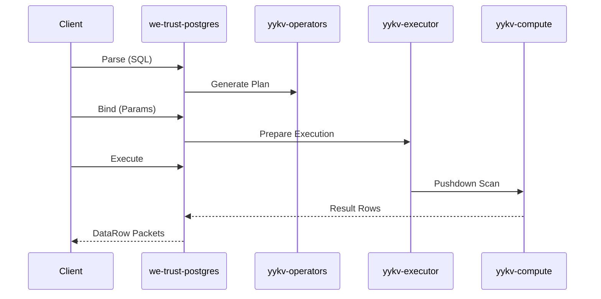

# PostgreSQL Compatibility Protocol

**we-trust-postgres** implements the PostgreSQL Frontend/Backend Wire Protocol, allowing YYKV to seamlessly integrate with the PostgreSQL ecosystem.

## 1. Protocol Flow

1. **Startup Phase**: The client sends a `StartupMessage` containing the protocol version and parameters (e.g., tenant identification `user=tenant_id`).
2. **Authentication Phase**: Supports `CleartextPassword` and `MD5Password` (Trust's native signature authentication is recommended for production).
3. **Command Loop (Simple/Extended Query)**:
   - **Simple Query**: Client sends a text query message.
   - **Extended Query**: Consists of four phases: `Parse`, `Bind`, `Describe`, and `Execute`, supporting parameter binding and high-performance repeated execution.

## 2. Message Format

Each message consists of a **1-byte Identifier**, **4-byte Length**, and a **Payload**:

| Identifier | Meaning |
| :--- | :--- |
| `'Q'` | Simple Query |
| `'P'` | Parse (Prepared Statement) |
| `'B'` | Bind Parameters |
| `'E'` | Execute |
| `'C'` | Command Complete |

## 3. Core Mapping Technology

### 3.1 Extended Query Mapping
PostgreSQL's extended query protocol is mapped to YYKV's `MessageType::Query`:
- **`Parse`**: Generates an execution plan cache within YYKV.
- **`Bind`**: Maps binary parameters transmitted over the network into a `YYValue` sequence.
- **`Execute`**: Triggers the asynchronous execution flow of the operator graph (OpsGraph).

### 3.2 Error Code Compatibility
YYKV translates internal storage errors into PostgreSQL standard `SQLSTATE` error codes (e.g., `23505` for unique constraint violation), ensuring that upper-layer ORMs (like Hibernate or Diesel) can correctly handle exceptions.

## 4. Execution Flow

## 5. Type System Alignment

| Postgres OID | YYKV Type | Description |
| :--- | :--- | :--- |
| `INT4`, `INT8` | `Int` | Mapped to 64-bit integer |
| `TEXT`, `VARCHAR` | `String` | UTF-8 encoded |
| `BYTEA` | `Binary` | Raw byte blocks |
| `BOOL` | `Bool` | Boolean value |

## 6. Advanced Feature: Operator Pushdown

When connecting via a PostgreSQL client, complex filtering conditions (WHERE clauses) are identified by the compatibility layer and pushed directly to the storage nodes using `yykv-compute`. Only rows meeting the conditions are returned, significantly saving network bandwidth.
