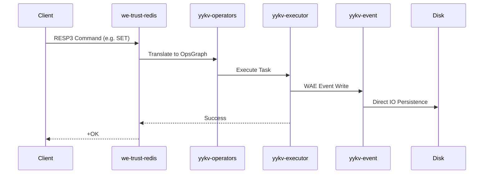

# Redis Compatibility Protocol

**we-trust-redis** implements the Redis Serialization Protocol (RESP), allowing YYKV to serve as a high-performance, persistent alternative to Redis.

## 1. Protocol Core: RESP

YYKV fully supports various data types of RESP (REdis Serialization Protocol):
- **Simple Strings**: Starts with `+`, e.g., `+OK\r\n`.
- **Errors**: Starts with `-`, includes error type.
- **Integers**: Starts with `:`.
- **Bulk Strings**: Starts with `$`, binary-safe.
- **Arrays**: Starts with `*`, supports nested structures.

## 2. Command Mapping Logic

The Redis compatibility layer employs a **dynamic mapping engine** that converts common KV operations directly into YYKV native atomic instructions, bypassing SQL parsing overhead.

| Redis Command | YYKV Native Operation | Performance |
| :--- | :--- | :--- |
| `SET` | `MessageType::Put` | $O(1)$, direct write to WAL and MemTable |
| `GET` | `MessageType::Get` | $O(1)$, supports cache hit optimization |
| `DEL` | `MessageType::Delete` | $O(1)$, writes a deletion marker (Tombstone) |
| `KEYS` | `MessageType::Scan` | $O(N)$, utilizes prefix scanning optimization |

## 3. Architecture & Execution Flow

The following diagram shows how a Redis command is processed within the YYKV kernel:

## 4. Persistence & Consistency

Unlike standard Redis AOF/RDB, YYKV provides **database-grade persistence guarantees** for the Redis protocol:
- **WAL Strong Sync**: Ensures logs are flushed to disk before returning from a `SET` operation.
- **Multi-Level Tiering**: Hot data stays in Memory/SSD, while cold data automatically migrates to HDD, breaking the memory capacity limit of Redis.

## 5. Multi-Tenant Extensions

YYKV provides non-destructive extensions to the Redis protocol:
- **Tenant Prefixing**: Internal physical isolation via Tenant IDs, transparent to the client.
- **Enhanced AUTH**: Supports fine-grained tenant-level authentication via `AUTH <tenant_id> <password>`.

## 6. Performance Advantages

- **Zero-Copy Path**: Leverages the `bytes` crate to directly mount data from network buffers into the storage engine, avoiding frequent `sds` string copies internal to Redis.
- **Multi-Core Concurrency**: Powered by Rust's `tokio` scheduler, YYKV fully utilizes multi-core CPUs to handle Redis requests, overcoming the bottleneck of the single-threaded Redis model.
