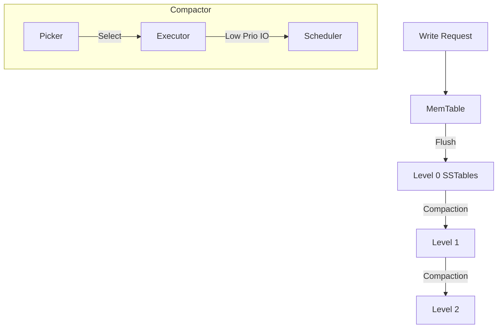

# yykv-compaction (LSM-Tree Compaction Engine)

`yykv-compaction` 是 YYKV 存储引擎的后台维护内核。它负责管理 LSM-Tree 架构中的 SSTable 合并过程，旨在通过消除空间碎片、清理已删除条目（Tombstones）以及优化数据布局，确保系统长期的读写性能。

## 核心功能

### 🧹 背景压缩 (Background Compaction)
- **空间放大控制**: 自动识别层级过深或文件过多的层级，触发合并任务。
- **冷数据压缩**: 配合 `yykv-tiering`，在数据搬运至 HDD 时进行大块合并，优化磁盘寻址。

### 🛡️ 压缩策略 (Compaction Strategies)
- **Leveled Compaction**: 严格控制每层数据量，提供更稳定的读延迟。
- **Size-Tiered Compaction**: 优化写入吞吐量，适用于高频写入场景。
- **Time-Window Compaction**: 针对时序数据的特殊优化策略。

### ⚡ IO 隔离与限制
- 集成 `yykv-scheduler` 的 **Low Priority** 调度，确保压缩过程不会抢占前端查询的磁盘带宽。
- 支持限速（Rate Limiting），防止压缩瞬间造成系统 IO 抖动。

## 核心组件

- `CompactionPicker`: 负责决定哪些文件需要进行合并。
- `CompactionExecutor`: 执行具体的读取、合并、排序及落盘逻辑。
- `TombstoneCleaner`: 专门负责处理物理删除条目的清理。

## 技术架构

