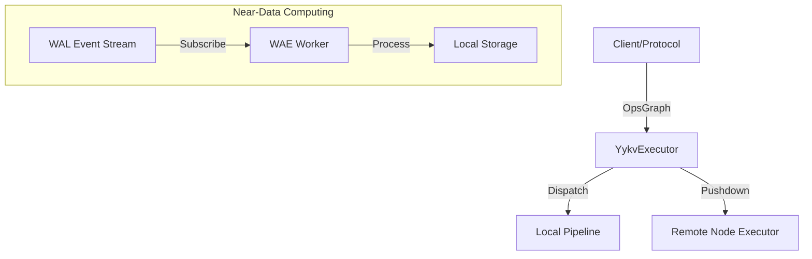

# yykv-executor (Distributed Execution Framework)

`yykv-executor` 是 YYKV 存储引擎的计算大脑。它负责将抽象的算子图（`OpsGraph`）转化为具体的执行任务流，并利用“近数据计算”（Near-Data Computing）技术，最大限度地在存储节点本地完成数据过滤与预处理。

## 核心功能

### 🚀 算子执行与调度
- **OpsGraph 执行**: 将来自上层的逻辑执行计划转化为物理算子管道（Pipeline），驱动数据流转。
- **异步驱动**: 基于 `tokio` 运行时，实现全异步、非阻塞的计算任务执行。

### 📡 近数据计算 (Near-Data Computing)
- **WAE Worker**: 核心组件，通过订阅 `yykv-event` 产生的 WAL 事件流，在数据落盘的同时触发预定义的计算逻辑（如索引更新、物化视图维护）。
- **任务下推**: 支持将 Filter, Project 等简单算子下推至数据所在节点，大幅减少跨网络的数据搬运。

### 🛡️ 多租户隔离
- 确保不同租户的计算任务在 CPU 时间片和内存配额上受到严格隔离，防止“嘈杂邻居”效应。

## 核心组件

- `YykvExecutor`: 全局执行控制器，负责任务分发与状态管理。
- `WaeWorker`: 专门处理实时数据事件流的计算单元。
- `TaskContext`: 封装租户信息、资源限制及追踪 ID 的执行上下文。

## 技术架构

## 技术优势
- **极低延迟**: 计算逻辑直接作用于 `yykv-layout` 的物理页面或内存缓存。
- **水平扩展**: 支持计算节点的动态扩缩容，计算任务可在集群内灵活移动。
