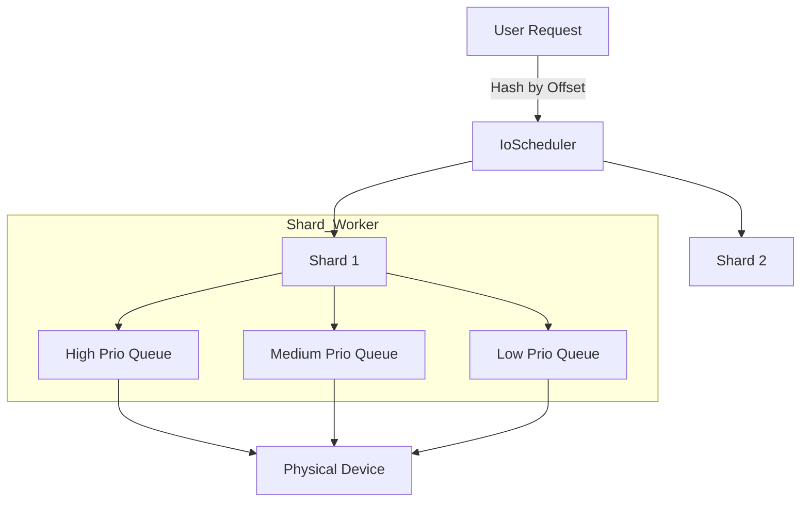

# yykv-scheduler (Priority-Aware IO Scheduler)

`yykv-scheduler` 是 YYKV 存储引擎的 IO 调度中心。它通过对 IO 请求进行优先级划分、多分片（Sharding）并发控制以及公平调度，确保了在复杂的后台维护任务（如 Compaction/GC）干扰下，前端查询请求仍能保持低延迟。

## 核心功能

### 🚥 优先级驱动调度 (Priority-Driven)
系统将所有 IO 请求划分为三个等级：
- **High (高优先级)**: 关键元数据读写、WAL 顺序写入。这些请求会抢占执行资源，确保数据库的响应速度与安全性。
- **Medium (中优先级)**: 标准的用户 SQL 查询与 KV 读写请求。
- **Low (低优先级)**: 后台 Compaction、数据分层搬运（Tiering）、垃圾回收（GC）。仅在系统负载较低时执行，避免拖慢正常业务。

### 🧩 多分片架构 (IO Sharding)
为了消除单队列锁竞争，调度器内部实现了基于 `PageId` 或 `Offset` 的多分片机制。
- 每个分片拥有独立的任务队列与 Worker 协程。
- 减少了多核环境下的 Context Switch 与 Cache Miss。

### 🛡️ 并发控制与背压
- **信号量限流**: 每个分片内置可配置的信号量，严格控制在途（In-flight）IO 数量，防止 NVMe 驱动器队列溢出。
- **背压感知**: 当队列积压超过阈值时，自动向上层返回等待信号，防止内存 OOM。

## 核心组件

- `IoScheduler`: 全局调度入口，负责分片映射。
- `IoShard`: 独立的分片执行单元，管理 `high`/`med`/`low` 三类通道。
- `IoPriority`: 优先级枚举定义。

## 使用示例

```rust
use yykv_scheduler::{IoScheduler, IoPriority, IoRequest};

let scheduler = IoScheduler::new(device, 16, 4); // 4分片，每分片16并发

// 发起一个高优先级的读取请求
let (tx, rx) = oneshot::channel();
scheduler.schedule(IoRequest::Read {
    offset: 4096,
    len: 4096,
    priority: IoPriority::High,
    resp: tx,
});

let data = rx.await??;
```

## 技术设计


