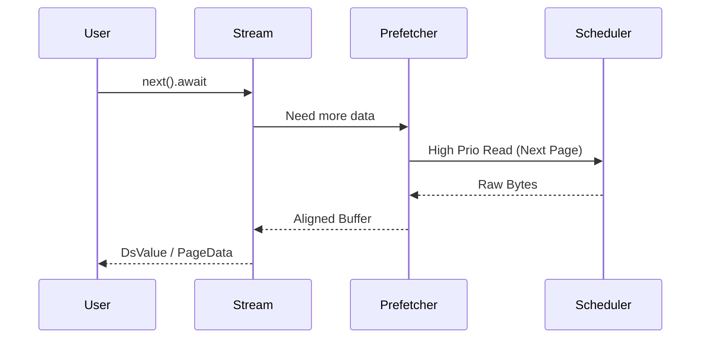

# yykv-stream (Async Data Streaming Interface)

`yykv-stream` 为 YYKV 提供了高效的异步流式数据访问接口。它封装了底层复杂的页面预取（Prefetching）与缓存管理逻辑，为上层引擎提供符合 Rust `Stream` 特性的数据迭代能力。

## 核心功能

### 🌊 异步流式扫描 (Async Scanning)
支持对海量存储数据进行流式读取，避免一次性加载导致的内存溢出（OOM）。
- **零拷贝迭代**: 尽可能返回对内部缓冲区的引用，减少内存拷贝开销。
- **并发预取**: 在处理当前页面的同时，异步从 `yykv-scheduler` 预取后续页面，消除磁盘 IO 等待。

### 🛡️ 智能背压 (Backpressure Control)
配合上层执行引擎，根据消费者的处理速度动态调整读取频率：
- 缓冲区满时自动暂停 IO 提交。
- 确保系统在处理大规模聚合或排序任务时的稳定性。

### 🧩 多租户感知
流式接口天然支持租户隔离，确保每个 `Stream` 仅能访问授权的物理页面。

## 核心组件

- `YykvStream`: 主流对象，实现了 `futures::Stream` 特征。
- `Prefetcher`: 背景页面预取器，管理前瞻性 IO 请求。

## 使用示例

```rust
use yykv_stream::YykvStream;
use futures::StreamExt;

let mut stream = YykvStream::new(page_ids, scheduler);

while let Some(page_result) = stream.next().await {
    let page_data = page_result?;
    // 处理页面数据...
}
```

## 技术设计


