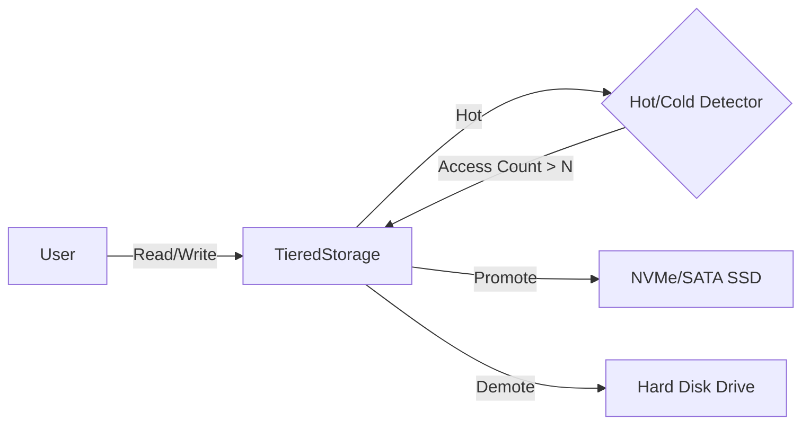

# yykv-tiering (Auto-Tiering Storage Engine)

`yykv-tiering` 是 YYKV 存储引擎的冷热数据分层管理模块。它实现了跨物理介质的自动数据搬运，旨在实现高性能（NVM/SSD）与低成本（HDD）的完美平衡。

## 核心功能

### 🔥 冷热探测 (Hot/Cold Detection)
基于 `HotColdDetector` 记录数据页面的访问频率：
- **热点识别**: 当页面访问次数超过预设阈值（默认 10 次）时，标记为“热”页面。
- **自动晋升 (Promotion)**: 检测到热页面位于慢速介质（如 HDD）时，自动异步搬运至快速介质（如 NVMe SSD）。

### ❄️ 自动降级 (Demotion)
后台任务扫描长时间未访问的冷页面，并将其从昂贵的 SSD 迁移至大容量 HDD，释放高性能空间。

### 🗺️ 透明映射 (Transparent Physical Mapping)
维护 `PageId` 到 `(MediumType, PhysicalOffset)` 的动态映射关系：
- 上层引擎无需关心数据存储的具体物理介质。
- 数据搬运过程中，映射关系原子化更新，确保访问的一致性。

## 核心组件

- **HotColdDetector**: 统计页面访问计数。
- **TieredStorage**: 核心管理器，协调多个介质驱动与分配器。
- **Promotion Manager**: 负责从 HDD 到 SSD 的数据晋升。

## 使用示例

```rust
let mut storage = TieredStorage::new();

// 添加不同介质的设备
storage.add_device(MediumType::NvmeSSD, ssd_device);
storage.add_device(MediumType::HDD, hdd_device);

// 写入数据（默认先落入 SSD）
let page_id = storage.write_value(&my_data).await?;

// 多次访问触发热点检测
for _ in 0..20 {
    let _ = storage.read_value(page_id).await?;
}

// 若数据在 HDD，此处将自动触发向 SSD 的晋升
```

## 技术架构


