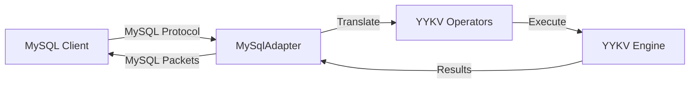

# we-trust-mysql (MySQL Protocol Adapter)

`we-trust-mysql` 是 YYKV 的 MySQL 兼容接入层。它完整实现了 MySQL 的客户端/服务器通信协议，使现有的 MySQL 生态系统能够无缝接入 YYKV 存储内核。

## 核心功能

### 🐬 MySQL 协议兼容
- **连接管理**: 支持 Handshake、Authentication 及命令执行的全生命周期管理。
- **高性能编解码**: 基于 `tokio-util` 的 `MySqlCodec` 实现，支持高效的二进制包解析。
- **序列 ID 维护**: 自动管理 MySQL 协议要求的 Sequence ID。

### 📊 算子转换
- 将 MySQL 的文本查询及预处理语句（Prepared Statements）映射为 YYKV 的物理执行算子。
- 支持常见的 DDL 与 DML 操作。

### 🛡️ 租户隔离
- 映射 MySQL 的 `DATABASE` 或 `SCHEMA` 概念到 YYKV 的物理租户空间。

## 核心组件

- `MySqlCodec`: 实现 MySQL 协议包的分帧与编解码。
- `MySqlAdapter`: 核心适配器，负责请求分发。
- `MySqlConnection`: 维护每个客户端连接的状态与事务上下文。

## 使用示例

```bash
# 使用标准 mysql 客户端连接
mysql -h 127.0.0.1 -P 3306 -u root -p
```

## 技术架构


