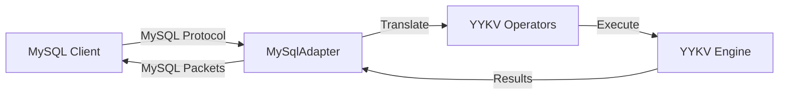

# we-trust-mysql (MySQL Protocol Adapter)

`we-trust-mysql` is the MySQL-compatible access layer for YYKV. It fully implements the MySQL client/server communication protocol, enabling the existing MySQL ecosystem to seamlessly connect to the YYKV storage kernel.

## Core Features

### 🐬 MySQL Protocol Compatibility
- **Connection Management**: Supports the full lifecycle of Handshake, Authentication, and command execution.
- **High-Performance Codec**: Implemented based on `tokio-util`'s `MySqlCodec`, supporting efficient binary packet parsing.
- **Sequence ID Maintenance**: Automatically manages the Sequence IDs required by the MySQL protocol.

### 📊 Operator Conversion
- Maps MySQL text queries and Prepared Statements to YYKV physical execution operators.
- Supports common DDL and DML operations.

### 🛡️ Tenant Isolation
- Maps MySQL's `DATABASE` or `SCHEMA` concepts to YYKV's physical tenant spaces.

## Core Components

- `MySqlCodec`: Implements framing and encoding/decoding of MySQL protocol packets.
- `MySqlAdapter`: The core adapter responsible for request distribution.
- `MySqlConnection`: Maintains the state and transaction context for each client connection.

## Usage Example

```bash
# Connect using the standard mysql client
mysql -h 127.0.0.1 -P 3306 -u root -p
```

## Technical Architecture


