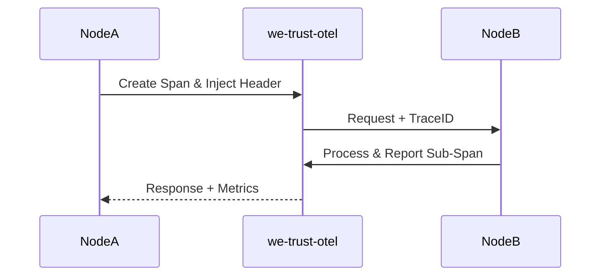

# we-trust-otel (OpenTelemetry Observability Extension)

`we-trust-otel` 为 YYKV 的核心通信协议 [we-trust](file:///e:/yydb/yykv/protocols/we-trust) 提供了全方位的可观测性增强。它将 OpenTelemetry 的分布式追踪（Tracing）与指标（Metrics）采集深度集成到存储引擎的底层链路中。

## 核心功能

### 🔍 分布式追踪 (Distributed Tracing)
- **上下文传播**: 自动在 `we-trust` 协议头部注入并提取 `TraceContext`，实现跨节点的请求链路追踪。
- **Span 管理**: 为每次 IO 请求、算子执行及数据搬运自动创建 Span，记录关键路径的执行时间与状态。

### 📊 指标采集 (Metrics Collection)
- **协议监控**: 实时收集通信延迟、吞吐量（Throughput）及请求错误率。
- **资源画像**: 监控 IO 调度队列深度与内存缓冲池使用情况。

### 🛡️ 安全审计集成
将所有通信链路的元数据导出为标准 OTLP 格式，支持对接 Jaeger、Prometheus 及 Grafana。

## 核心组件

- `OtelCodec`: 扩展基础编解码器，支持追踪元数据的透明处理。
- `OtelInterceptor`: 拦截请求流，自动上报监控指标。

## 技术原理

