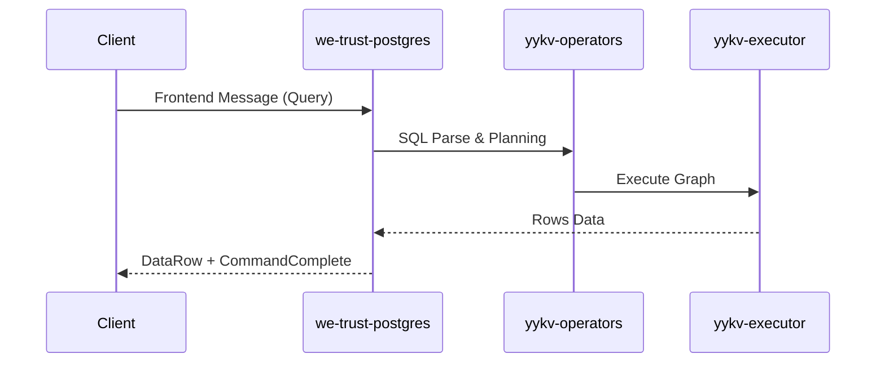

# we-trust-postgres (PostgreSQL Wire Protocol Adapter)

`we-trust-postgres` is the PostgreSQL protocol compatibility layer for the YYKV storage engine. It implements the PostgreSQL wire protocol, allowing developers to directly access YYKV's high-performance integrated storage-compute capabilities using existing Postgres drivers, ORM frameworks, and management tools.

## Core Features

### 🔌 Native Protocol Support (Wire Protocol)
- **Binary Transmission**: Fully implements the message formats for front-end/back-end interaction (e.g., `StartupMessage`, `Query`, `DataRow`, `CommandComplete`).
- **Authentication Integration**: Supports common Postgres authentication mechanisms.
- **SSL Support**: Supports encrypted connections to ensure data transmission security.

### 📊 Type & Operator Mapping
- **Bidirectional Conversion**: Establishes high-performance mapping between Postgres data types and YYKV's `DsValue`.
- **SQL Translation**: Translates received SQL statements into YYKV logical execution plans (OpsGraph).

### ⚡ Transaction Transparency
- Maps Postgres transaction commands (`BEGIN`, `COMMIT`, `ROLLBACK`) to YYKV's underlying transaction controller, ensuring ACID properties.

## Core Components

- `PgCodec`: A non-blocking Postgres message codec implemented based on `tokio-util`.
- `PostgresAdapter`: Manages client connection lifecycle and request routing.
- `PostgresTransaction`: Maintains transaction context corresponding to the underlying engine.

## Usage Example

```bash
# Connect to YYKV using the standard psql client
psql -h 127.0.0.1 -p 5432 -U yykv_user -d my_database
```

## Technical Architecture


