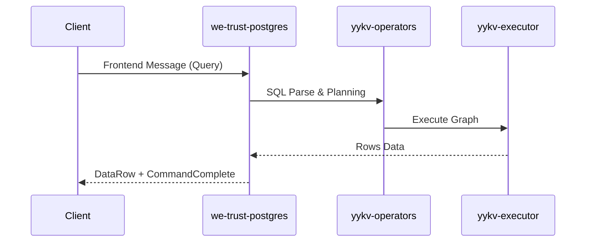

# we-trust-postgres (PostgreSQL Wire Protocol Adapter)

`we-trust-postgres` 是 YYKV 存储引擎的 PostgreSQL 协议兼容层。它实现了 PostgreSQL 的有线协议（Wire Protocol），使得开发者可以使用现有的 Postgres 驱动、ORM 框架及管理工具直接访问 YYKV 的高性能存算一体化能力。

## 核心功能

### 🔌 原生协议支持 (Wire Protocol)
- **二进制传输**: 完整实现前端/后端交互的消息格式（如 `StartupMessage`, `Query`, `DataRow`, `CommandComplete`）。
- **认证集成**: 支持常用的 Postgres 认证机制。
- **SSL 支持**: 支持加密连接，确保数据传输安全。

### 📊 类型与算子映射
- **双向转换**: 在 Postgres 数据类型与 YYKV 的 `DsValue` 之间建立高性能映射。
- **SQL 翻译**: 将接收到的 SQL 语句转化为 YYKV 的逻辑执行计划（OpsGraph）。

### ⚡ 事务透明
- 映射 Postgres 的事务命令（`BEGIN`, `COMMIT`, `ROLLBACK`）到 YYKV 的底层事务控制器，确保 ACID 特性。

## 核心组件

- `PgCodec`: 基于 `tokio-util` 实现的非阻塞 Postgres 消息编解码器。
- `PostgresAdapter`: 负责处理客户端连接生命周期与请求路由。
- `PostgresTransaction`: 维护与底层引擎对应的事务上下文。

## 使用示例

```bash
# 使用标准 psql 客户端连接 YYKV
psql -h 127.0.0.1 -p 5432 -U yykv_user -d my_database
```

## 技术架构


