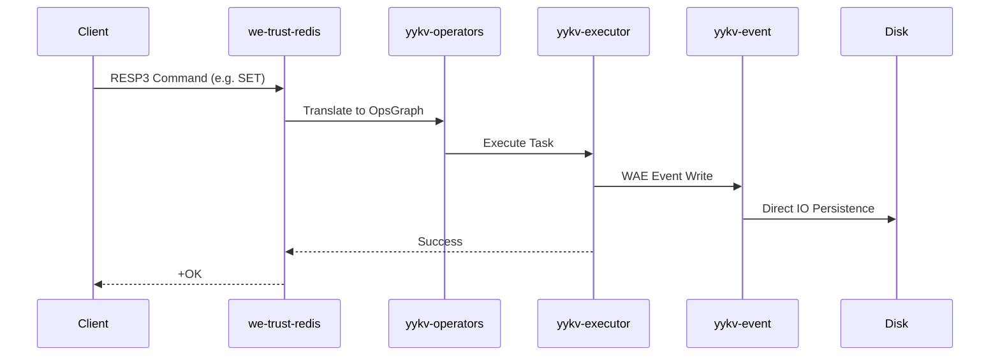

# we-trust-redis (RESP3 Protocol Adapter)

`we-trust-redis` 是 YYKV 的高性能 Redis 协议接入层。它将 YYKV 的存算一体化能力通过标准 RESP (Redis Serialization Protocol) 暴露给现有的生态系统，支持低延迟的 KV 操作与实时事件流。

## 核心技术实现

### 🚀 高并发 RESP 解码
基于 `tokio-util` 的 `Codec` 机制与 `bytes` 库实现非阻塞编解码。
- **RESP3 支持**: 完美处理 Map, Set, Push 等新协议类型。
- **零拷贝解析**: 在协议层尽量保留对原始字节切片的引用，减少内存分配。

### 🧠 算子图映射 (Command to OpsGraph)
Redis 命令不只是简单的 Key 查找，`we-trust-redis` 将其映射为 YYKV 的物理算子：
- `GET/SET` -> `TableScan` + `Filter` / `Insert`。
- `HGETALL` -> 范围扫描算子。
- 复杂聚合逻辑自动下推至 `yykv-compute`。

### ⚡ 实时订阅集成
利用 YYKV 的 **WAE (写入即事件)** 架构，Redis 协议层天然支持高性能的 `SUBSCRIBE` 机制，甚至可以订阅特定租户或表的物理变更流。

## 关键特性

- **多租户隔离**: 通过协议扩展或逻辑映射，支持不同 Redis 客户端连接到不同的物理租户空间。
- **持久化策略控制**: 支持通过 Redis 命令自定义 `SDR` (软件定义冗余) 等级。
- **高性能**: 单实例 QPS 目标 > 500k (Pipeline 模式)。

## 兼容命令集

- **Strings**: `GET`, `SET`, `INCR`, `MGET`, `MSET`
- **Hashes**: `HGET`, `HSET`, `HGETALL`, `HDEL`
- **Sets**: `SADD`, `SMEMBERS`, `SISMEMBER`
- **System**: `PING`, `INFO`, `CLIENT`, `COMMAND`

## 使用示例

```bash
# 使用标准 redis-cli 连接
redis-cli -h 127.0.0.1 -p 6379
127.0.0.1:6379> SET mykey "yykv-power"
OK
127.0.0.1:6379> GET mykey
"yykv-power"
```

## 技术架构图


