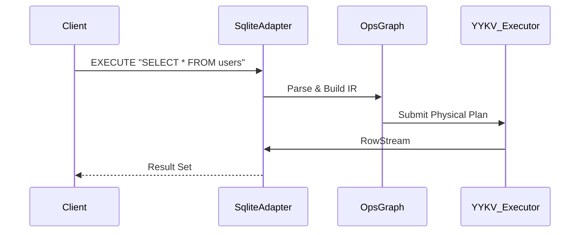

# we-trust-sqlite (SQLite Compatibility Layer)

`we-trust-sqlite` is the SQLite compatibility layer for YYKV. It enables YYKV to provide services as a "single-file database" while maintaining deep compatibility with standard SQLite file formats (B-Tree Page) and SQL syntax. It is a key component for smooth upgrades from embedded databases to high-performance tiered storage.

## Core Design

### 📁 Native File Compatibility
- **B-Tree Mapping**: Capable of directly reading and writing `.db` files that comply with standard SQLite page formats.
- **Page Adaptation**: Establishes bidirectional mapping between SQLite's B-Tree page model and YYKV's physical layout, supporting standard Page Cache mechanisms.

### ⌨️ SQL Execution Engine
- **Syntax Support**: Integrates `sqlparser` to parse standard SQL statements.
- **Operator Conversion**: Translates SQL query plans into high-performance YYKV operator graphs (`OpsGraph`) for execution in the storage layer.

### 🔒 Concurrency & Transactions
- **ACID Features**: Implements SQLite-style shared/exclusive locking mechanisms to ensure transaction isolation.
- **WAL Mode Support**: Utilizes YYKV's `yykv-event` (WAE) mechanism to simulate SQLite's Write-Ahead Log.

## Core Components

- `SqliteAdapter`: Responsible for compiling SQL statements to `OpsGraph` and encapsulating result sets.
- `Pager`: A page manager optimized for asynchronous IO environments, supporting LRU cache policies.
- `BTree`: The core index structure, compatible with SQLite's physical page layout.

## Technical Architecture

## Use Cases
- **Embedded Upgrade**: Applications that need a local database but seek higher IO performance or multi-tenant isolation.
- **Hybrid Retrieval**: Running YYKV's unique vector similarity search on standard SQLite tables.
- **Cloud-Native Expansion**: Seamlessly migrating existing SQLite data to YYKV-driven cloud tiered storage.
