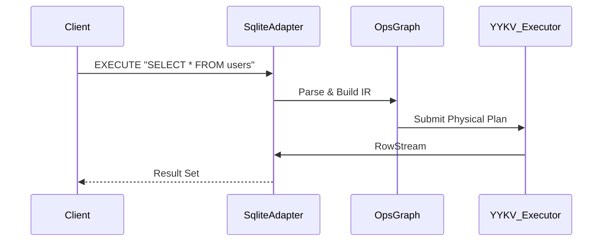

# we-trust-sqlite (SQLite Compatibility Layer)

`we-trust-sqlite` 是 YYKV 的 SQLite 兼容层。它使 YYKV 能够以“单文件数据库”的形式提供服务，同时保持与标准 SQLite 文件格式（B-Tree Page）及 SQL 语法的深度兼容，是实现从嵌入式数据库平滑升级到高性能分层存储的关键组件。

## 核心设计

### 📁 原生文件兼容
- **B-Tree 映射**: 能够直接读取和写入符合标准 SQLite 页面格式的 `.db` 文件。
- **页面适配**: 在 SQLite 的 B-Tree 页面模型与 YYKV 的物理布局之间建立双向映射，支持标准的页面缓存 (Page Cache) 机制。

### ⌨️ SQL 执行引擎
- **语法支持**: 集成 `sqlparser` 解析标准 SQL 语句。
- **算子转换**: 将 SQL 查询计划转化为 YYKV 高性能算子图（`OpsGraph`），在存储层执行。

### 🔒 并发与事务
- **ACID 特性**: 实现 SQLite 风格的共享/独占锁机制，确保事务隔离。
- **WAL 模式支持**: 利用 YYKV 的 `yykv-event` (WAE) 机制模拟 SQLite 的预写日志。

## 核心组件

- `SqliteAdapter`: 负责 SQL 语句到 `OpsGraph` 的编译与结果集封装。
- `Pager`: 专为异步 IO 环境优化的页面管理器，支持 LRU 缓存策略。
- `BTree`: 核心索引结构，兼容 SQLite 的物理页面布局。

## 技术架构

## 使用场景
- **嵌入式升级**: 需要本地数据库但追求更高 IO 性能或多租户隔离的应用。
- **混合检索**: 在标准的 SQLite 表上运行 YYKV 特有的向量相似度搜索。
- **云原生扩展**: 将现有的 SQLite 数据无缝搬运至 YYKV 驱动的云端分层存储。
