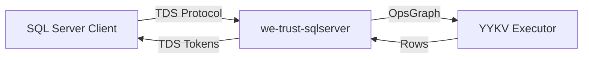

# we-trust-sqlserver (SQL Server TDS Compatibility)

`we-trust-sqlserver` 是 YYKV 的 SQL Server 兼容层。它实现了 Microsoft SQL Server 使用的 **TDS (Tabular Data Stream)** 协议，使得现有的 SQL Server 客户端、驱动程序（如 ADO.NET, JDBC, ODBC）能够像连接原生 SQL Server 一样访问 YYKV。

## 核心功能

### 🔌 TDS 协议适配
- **握手与认证**: 支持 TDS 协议的标准登录握手与预登录逻辑。
- **查询执行**: 将 TDS 封装的 SQL 查询转化为 YYKV 的 `OpsGraph` 算子图执行。
- **结果集封装**: 将 YYKV 的行数据流转换为 TDS 协议定义的行数据包（Token Streams）。

### 🗺️ 数据类型映射
- 实现了 SQL Server 标准类型（如 `INT`, `NVARCHAR`, `DATETIME2`）与 YYKV 内部类型（`DsValue`）之间的精确转换。

### 🛡️ 事务一致性
- 支持 TDS 协议中的事务管理指令，确保与 SQL Server 语义一致的 ACID 行为。

## 核心组件

- `TdsCodec`: 负责 TDS 数据包的二进制编解码。
- `SqlServerAdapter`: 将 TDS 请求分发至 YYKV 执行引擎。
- `TokenStream`: 实现了 TDS 协议中的各种 Token（ROW, COLMETADATA, DONE 等）。

## 使用示例

```bash
# 使用标准 SQL Server 客户端连接 (示例)
sqlcmd -S localhost,1433 -U sa -P MyPassword
```

## 技术架构


