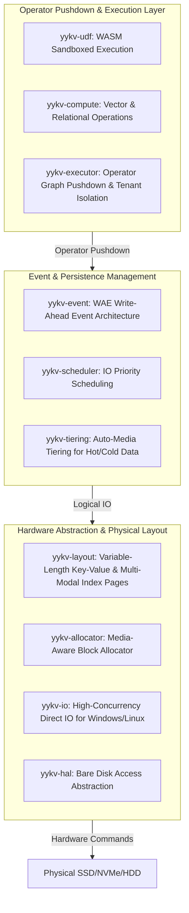

# YYKV (The Singular Key-Value) - Bare-Metal Integrated Storage & Compute Kernel

YYKV is the underlying storage kernel of the YY (YingYing) Database ecosystem. It aims to eliminate the performance gap caused by traditional operating systems and file systems by implementing extreme I/O throughput, precise data layout control, and a "Write-Ahead Event" (WAE) compute architecture directly on bare hardware.

## 1. Core Technical Architecture

YYKV adopts a vertically integrated architecture design, with every layer optimized from physical hardware abstraction to operator pushdown execution.



## 2. Core Competitive Advantages

### 🚀 Bypass FS: Ultra-Fast Physical Access
Directly manage block devices via `yykv-hal`, skipping file system metadata locks, page cache pollution, and complex VFS calls. Combined with the `FILE_FLAG_NO_BUFFERING` mechanism on Windows, I/O latency reaches the hardware's theoretical limit.

### 🧠 Near-Data Computing: Integrated Storage & Compute
Data no longer needs frequent transfer over the PCI-E bus. `yykv-compute` allows operators to execute directly during the storage page scanning process.
- **Vector Retrieval**: Built-in Cosine/L2 similarity operators.
- **Relational Filtering**: Supports SQL predicate pushdown.

### ⚡ WAE (Write-Ahead Event): Write-Ahead Event
No longer just traditional WAL (Write-Ahead Log). In YYKV, every write is a subscribable event stream.
- **Real-time**: WAE Workers (`yykv-executor`) perceive data changes in milliseconds.
- **Flexibility**: Supports Software-Defined Redundancy (SDR), dynamically adjusting replica strategies based on data importance.

### ❄️ Auto-Tiering: Cold/Hot Media Awareness
`yykv-tiering` automatically performs silent data migration between NVMe (Hot), SSD (Warm), and HDD (Cold) based on access frequency and decay policies, achieving the highest throughput per unit cost.

## 3. Package Matrix

| Module | Core Features | Use Cases |
| :--- | :--- | :--- |
| **[yykv-io](file:///e:/yydb/yykv/backends/kv-store/yykv-io)** | Async Aligned IO, DMA Memory Management | Extreme low-latency R/W |
| **[yykv-event](file:///e:/yydb/yykv/backends/kv-store/yykv-event)** | WAE Architecture, SDR Redundancy Control | Data consistency & real-time subscription |
| **[yykv-compute](file:///e:/yydb/yykv/backends/kv-store/yykv-compute)** | SIMD Vector Acceleration, Predicate Pushdown | AI retrieval & big data filtering |
| **[yykv-layout](file:///e:/yydb/yykv/backends/kv-store/yykv-layout)** | Variable-length Data Org, CRC32C Checksum | Physical storage reliability |
| **[yykv-allocator](file:///e:/yydb/yykv/backends/kv-store/yykv-allocator)** | Media-aware Allocation, Defragmentation | Efficient bare-disk space utilization |

## 4. Access & Protocols

YYKV provides multi-modal access capabilities through the [we-trust](file:///e:/yydb/yykv/backends/protocols/we-trust) protocol series:
- **Redis**: [we-trust-redis](file:///e:/yydb/yykv/backends/protocols/we-trust-redis) provides RESP3 compatibility.
- **SQLite**: [we-trust-sqlite](file:///e:/yydb/yykv/backends/protocols/we-trust-sqlite) provides local embedded SQL access.
- **Postgres**: [we-trust-postgres](file:///e:/yydb/yykv/backends/protocols/we-trust-postgres) compatible with PG wire protocol.

## 5. Development & Benchmarking

### Build Environment
- **Rust**: 1.75+ (Stable)
- **OS**: Windows (Server/Pro) or Linux (Kernel 5.10+ for io_uring)

### Quick Start
```bash
# Build full project
cargo build --release

# Run performance benchmarks
cargo run -p yykv-bench -- --threads 16 --duration 60s
```

---
*YYKV is part of the YY (YingYing) Database ecosystem. Developed with ❤️ for the next generation of storage infrastructure.*
