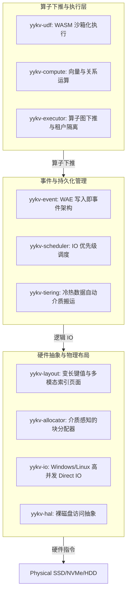

# YYKV (The Singular Key-Value) - 裸硬件存算一体化内核

YYKV 是独一数据库 (YY) 生态的底层存储内核，旨在消除传统操作系统与文件系统带来的性能鸿沟，直接在裸硬件上实现极致的 I/O 吞吐、精准的数据布局控制与“写入即事件” (WAE) 的计算架构。

## 1. 核心技术架构

YYKV 采用垂直整合的架构设计，从物理硬件抽象到算子下推执行，每一层都经过极致优化。



## 2. 核心竞争力 (Core Competitive Advantages)

### 🚀 Bypass FS: 极速物理访问
通过 `yykv-hal` 直接接管块设备，跳过文件系统的元数据锁、页缓存污染与复杂的 VFS 调用。结合 Windows 平台的 `FILE_FLAG_NO_BUFFERING` 机制，I/O 延迟达到硬件理论极限。

### 🧠 Near-Data Computing: 存算一体
数据无需经过 PCI-E 总线频繁传输。`yykv-compute` 允许算子直接在存储页扫描过程中执行。
- **向量检索**: 内置 Cosine/L2 相似度算子。
- **关系过滤**: 支持 SQL 谓词下推。

### ⚡ WAE (Write-Ahead Event): 写入即事件
不再是传统的 WAL (Write-Ahead Log)。在 YYKV 中，每一次写入都是一个可订阅的事件流。
- **实时性**: WAE Worker (`yykv-executor`) 毫秒级感知数据变化。
- **灵活性**: 支持软件定义冗余 (SDR)，根据数据重要性动态调整副本策略。

### ❄️ Auto-Tiering: 冷热介质感知
`yykv-tiering` 会根据数据访问频次（Access Count）与衰减策略，自动在 NVMe (热)、SSD (温)、HDD (冷) 之间进行静默搬运，实现单位成本下的最高吞吐。

## 3. 子项目矩阵 (Package Matrix)

| 模块 | 核心特征 | 适用场景 |
| :--- | :--- | :--- |
| **[yykv-io](file:///e:/yydb/yykv/packages/yykv-io)** | 异步对齐 IO、DMA 内存管理 | 极致低延迟读写 |
| **[yykv-event](file:///e:/yydb/yykv/packages/yykv-event)** | WAE 架构、SDR 冗余控制 | 数据一致性与实时订阅 |
| **[yykv-compute](file:///e:/yydb/yykv/packages/yykv-compute)** | SIMD 向量加速、谓词下推 | AI 检索与大数据过滤 |
| **[yykv-layout](file:///e:/yydb/yykv/packages/yykv-layout)** | 变长数据组织、CRC32C 校验 | 物理存储可靠性 |
| **[yykv-allocator](file:///e:/yydb/yykv/packages/yykv-allocator)** | 介质感知分配、碎片整理 | 裸磁盘空间高效利用 |

## 4. 接入与协议

YYKV 通过 [we-trust](file:///e:/yydb/yykv/protocols/we-trust) 系列协议层提供多模态访问能力：
- **Redis**: [we-trust-redis](file:///e:/yydb/yykv/protocols/we-trust-redis) 提供 RESP3 兼容性。
- **SQLite**: [we-trust-sqlite](file:///e:/yydb/yykv/protocols/we-trust-sqlite) 提供本地嵌入式 SQL 访问。
- **Postgres**: [we-trust-postgres](file:///e:/yydb/yykv/protocols/we-trust-postgres) 兼容 PG 有线协议。

## 5. 开发与基准测试

### 构建环境
- **Rust**: 1.75+ (Stable)
- **OS**: Windows (Server/Pro) 或 Linux (Kernel 5.10+ for io_uring)

### 快速开始
```bash
# 构建全量项目
cargo build --release

# 运行性能基准测试
cargo run -p yykv-bench -- --threads 16 --duration 60s
```

---
*YYKV is part of the YY (YingYing) Database ecosystem. Developed with ❤️ for the next generation of storage infrastructure.*
